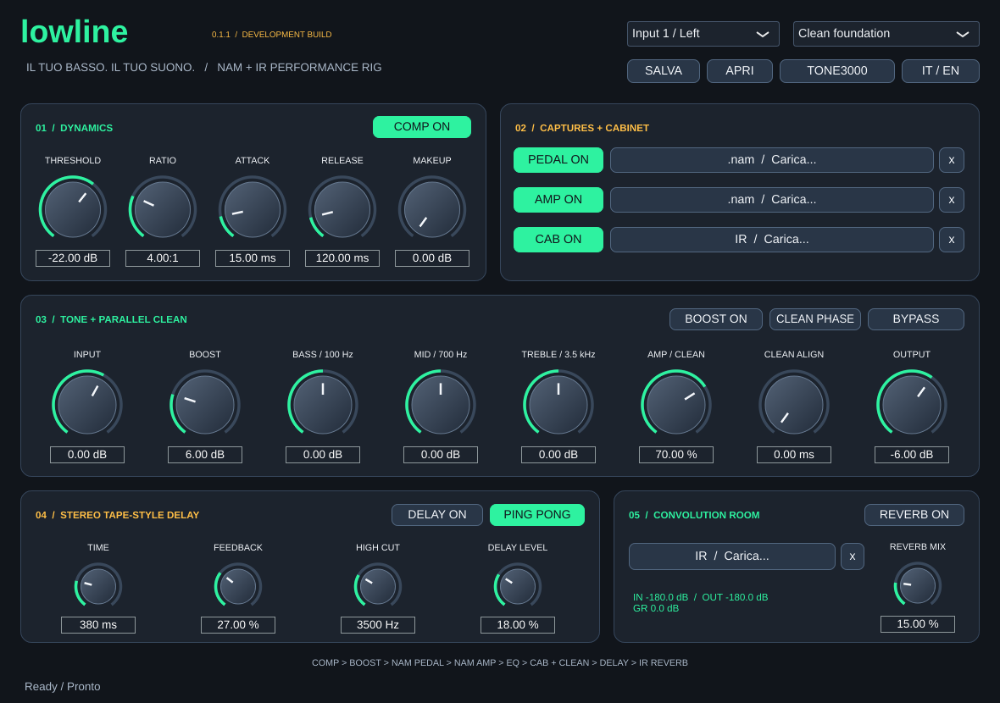
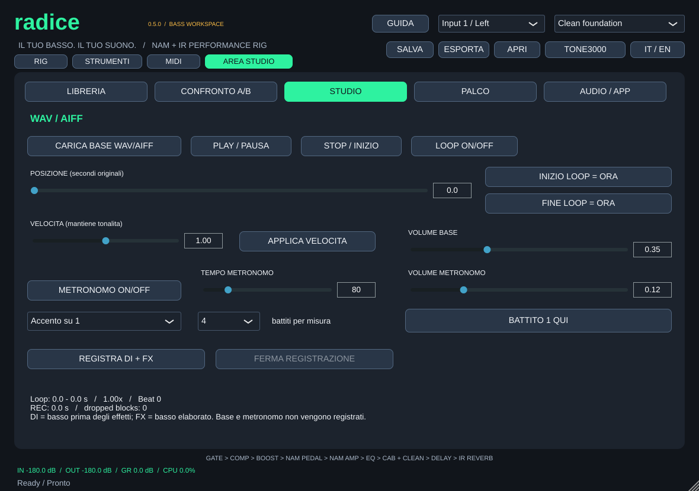
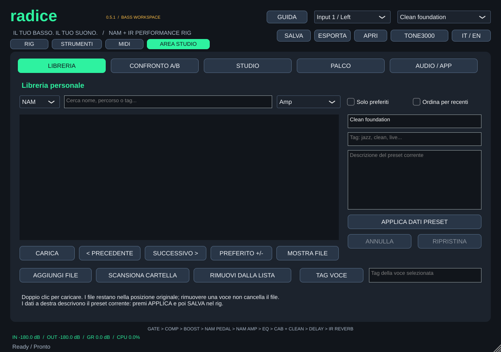
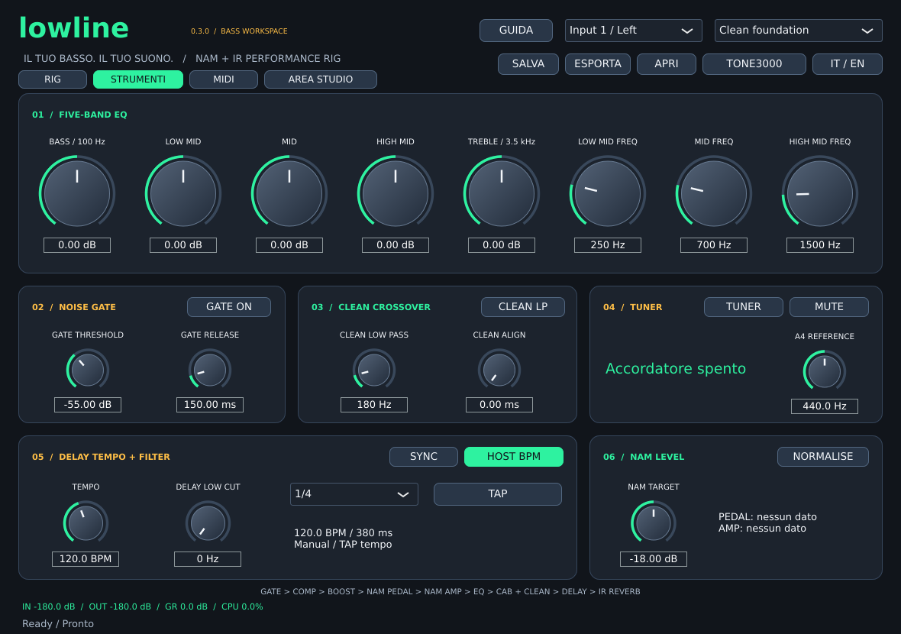
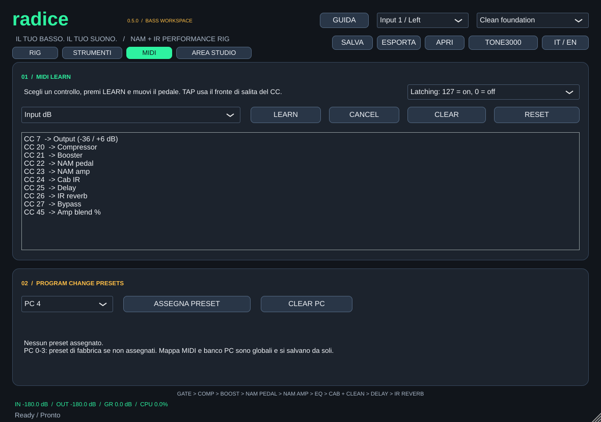
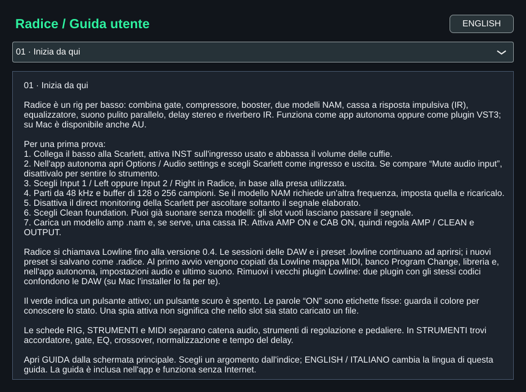

# Radice 0.5.0 — Bass NAM + IR rig

A free, open-source native bass rig for macOS (Apple Silicon + Intel), Windows x64 and Linux x64, plus an iPad/iPhone app and AUv3. Standalone and VST3; AU is also built for macOS. Original project for Massimo Danieli, not affiliated with NamRay, Neural Amp Modeler or TONE3000.

*Radice was called Lowline up to 0.4. DAW sessions and `.lowline` presets keep opening; see [Renamed from Lowline](#renamed-from-lowline).*

## ⬇️ Scarica / Download

**[🍎 Mac — Apple Silicon + Intel](https://github.com/MassimoDanieli/radice/releases/latest/download/Radice-macOS-universal.zip)** · **[Windows x64](https://github.com/MassimoDanieli/radice/releases/latest/download/Radice-Windows-x64.zip)** · **[Linux x64](https://github.com/MassimoDanieli/radice/releases/latest/download/Radice-Linux-x64.tar.gz)**

App pronta all'uso: non serve compilare. / Ready-built app: no compilation needed. These links always download the latest release.

[All downloads / Tutti i download](https://github.com/MassimoDanieli/radice/releases/latest) · [Guida italiana](docs/HELP_IT.md) · [English guide](docs/HELP_EN.md)



## New in 0.5

- **New name:** Lowline is now Radice — the root note, the one the bass plays.
- **DAW sessions:** a session no longer opens silent when the host changes sample rate or buffer while models load, and saving no longer erases the path of a capture that is missing on this machine.
- **MIDI:** factory Program Changes are applied off the audio thread; footswitches and Program Changes keep working while the host bypasses the plugin.

## Renamed from Lowline

- The plugin keeps its internal codes and bundle ID, so DAW sessions made with Lowline load Radice in its place.
- `.lowline` presets open as before; new presets are saved as `.radice`.
- MIDI map, Program Change bank, library, window size and the standalone app's audio setup are copied from Lowline on first launch (the originals are left in place).
- Mac: the installer moves an existing Lowline app/AU/VST3 in your user folders aside, because two plugins with the same codes confuse hosts. If you installed Lowline by hand (for example in /Library/Audio/Plug-Ins), remove the old `Lowline.*` bundles yourself. Windows/Linux: delete the old `Lowline.vst3` when you copy `Radice.vst3`.

## New in 0.3

- **Library:** folder indexing, NAM/IR/preset search, favourites, recent files, local tags and missing-file indicators.
- **A/B:** two temporary rig snapshots and a five-second RMS comparison with bounded ±12 dB match gain.
- **Practice:** WAV/AIFF backing player, loop points, offline pitch-preserving speed adjustment (0.5–1.5×), independent metronome with accents on beats 2 and 4.
- **Recording:** separate mono DI and stereo FX 32-bit float WAVs, written off the audio thread; backing/click excluded.
- **Presets:** name, tags, description, dirty indicator and control/metadata undo/redo.
- **Stage:** large tuner and preset controls, keyboard shortcuts, grouped capture preparation and one outgoing room tail.
- **Setup:** live audio diagnostics, setup checklist and on-demand link to the latest release.
- **Mac installation:** DMG and ZIP with a per-user installation helper; public packages remain unsigned/unnotarised.

[Mac DMG](https://github.com/MassimoDanieli/radice/releases/latest/download/Radice-macOS-universal.dmg) · [Installation instructions](packaging/README-INSTALL.txt)





## Rig features

- Monophonic bass tuner (25–500 Hz), A4 reference and smooth mute; pitch analysis runs off the audio thread.
- Noise gate with threshold, release, hysteresis and hold.
- Five-band EQ with three adjustable mid frequencies, plus optional 12 dB/octave low-pass on the parallel clean branch.
- Optional NAM level compensation from loudness metadata, bounded to ±18 dB per model. Models without valid metadata retain their gain.
- Delay sync to host or manual BPM, six subdivisions, tap tempo and low cut.
- MIDI learn for parameters and tap tempo, persistent mappings and PC 0–127 assignments to user presets.
- Portable .radice export containing the loaded NAM/IR assets.
- 50 ms crossfades for NAM and IR replacement. Engines are prepared and retired off the audio thread.
- Audio processing-load indicator and dedicated RIG, TOOLS and MIDI pages.

The rig also includes compression, saturation booster, NAM pedal and amp slots, cabinet IR, clean blend with polarity/alignment, stereo ping-pong delay, convolution reverb and a stereo-linked lookahead limiter.





## Download and quick start

Download a package using the links above, or open [Releases](https://github.com/MassimoDanieli/radice/releases/latest) and expand **Assets**. Choose the file for your operating system, not the automatically generated “Source code” archives. Extract the downloaded archive. Public release downloads do not require a GitHub account and do not have the 30-day Actions artifact expiry.

Every release is published only after native builds, regression tests and pluginval pass on macOS, Windows and Linux (and auval on macOS); the release notes link the run.

On Mac, run the standalone app or install the AU/VST3 bundle in your user's Audio/Plug-Ins folders. The app is not Developer-ID signed or notarised. See the guide for installation and audio setup.

For Scarlett 2i2: enable INST, select the matching input and Scarlett output, disable direct monitoring, and start at 48 kHz / 128 or 256 samples. If the standalone app has “Mute audio input” enabled, disable it. Set the interface's physical gain without clipping, then adjust software INPUT and OUTPUT. A capture may require a different sample rate; follow its status message.

No NAM captures or IRs are bundled. TONE3000 opens the website; download compatible assets and load them into the appropriate slots.

## Guides / Guide

Click **GUIDA / HELP** for the built-in offline manual, with eighteen indexed topics and language switching. The same files are published here:

- [Italiano — guida completa](docs/HELP_IT.md)
- [English — complete guide](docs/HELP_EN.md)
- [Validation and limitations](VALIDATION.md)
- [Changelog](CHANGELOG.md)



## Signal flow

Selected mono input → input gain → gate → compressor → split.

Processed branch: booster → NAM pedal → NAM amp → five-band EQ → cabinet IR.
Clean branch: optional low-pass → manual alignment → polarity.

Blend → stereo delay → convolution reverb → output gain → temporary A/B trim → backing + click → 1 ms lookahead limiter → tuner mute.

The clean branch includes gate/compression. Its low-pass does not high-pass the processed branch. Stereo input is summed or one channel is selected; stereo width comes from IRs and effects. Mono output folds both output channels together.

The limiter targets sample peaks at ±0.98, is stereo-linked and reports its latency to the host. It is not a true-peak limiter. INPUT changes how hard models are driven; OUTPUT changes final level. NAM normalisation is based on declared metadata, not measured LUFS matching or physical input calibration. Normalising a pedal also changes the drive into the amp.

## Presets and MIDI

**SAVE** stores controls and absolute asset paths; the MIDI map and PC bank are global controller settings, saved automatically. **EXPORT** embeds the four slots' assets (64 MB per file / 192 MB total). **OPEN** accepts either format. Portable assets are extracted to a persistent user-data cache; subsequent ordinary saves reference that cache. Export again to transfer them. Only redistribute assets for which you have permission. PC-assigned preset files are separate and are not recursively embedded.

MIDI learn: select a target on MIDI, click LEARN, move the controller. CLEAR removes that target's assignment; RESET restores defaults. Values 0–63 disable toggles and 64–127 enable them. Continuous controls span their full parameter range. Tap reacts to a rising edge; transmit release too. All MIDI channels are accepted.

Default CCs: 20 compressor, 21 booster, 22 pedal, 23 amp, 24 cab, 25 delay, 26 reverb, 27 bypass, 11 blend, 7 output (−36 to +6 dB). Learned output uses the full −36 to +12 dB range. Calibrate expression pedals on the controller.

PC 0–3 recalls factory starting configurations unless a user file is assigned. Any PC 0–127 can recall an assigned .radice (or .lowline) file on the background worker. The MIDI map and bank are global (one settings file for the app and all plugin instances): no preset, recalled or opened, ever changes them.

Older presets load with neutral defaults for the new effects. Keep backups when moving between versions; 0.2 exports are not designed for older versions.

## Build

CMake 3.24+, C++20 compiler. Dependencies are pinned: JUCE 8.0.6 and NAM core `0b3d3c97b0859a3a8c92a8628c4dd89a25eb5842` (A2 support). Repository builds fetch them; a local `third_party` checkout can be used offline.

```sh
cmake -S . -B build -DCMAKE_BUILD_TYPE=Release
cmake --build build --config Release --parallel 2
ctest --test-dir build -C Release --output-on-failure
```

Mac universal: add `'-DCMAKE_OSX_ARCHITECTURES=arm64;x86_64'` at configuration. Windows: Visual Studio 2022 Desktop C++ and CMake. Linux: development packages for ALSA, X11/Xext/Xinerama/Xrandr/Xcursor, FreeType, Fontconfig and OpenGL; see the workflow. Headless tests can use Xvfb.

### iPad / iPhone (app + AUv3)

Xcode 16+ on a Mac. CI compiles the iOS app and AUv3 on every push (unsigned). To install through TestFlight with Xcode's automatic signing — sign in to Xcode with your Apple Developer account and create the app (`com.massimodanieli.lowline`) once in App Store Connect — run:

```sh
LOWLINE_TEAM_ID=XXXXXXXXXX scripts/ios-testflight.sh
```

On iOS, picked files are copied into the app's Documents ("On My iPad › Radice"), presets and recordings are saved there, and the AUDIO button opens input/buffer settings. Landscape only; the interface is the iPad layout, scaled.

## Practical limits

Crossfades replace abrupt engine swaps, but temporarily run two engines per transitioning slot. Phase differences and CPU overruns can still be audible. Preset engines are prepared as a group, but controls apply before preparation finishes: this is not an atomic scene switch. One previous room tail may continue; another switch, clearing the room or changing the mix can truncate/mask it. There is no automatic model sample-rate conversion.

The tuner is monophonic and can be confused by strong harmonics/noise. Gate, EQ and level settings require adjustment for the instrument. The booster is a simple host-rate saturation and can alias at high drive. The CPU display is callback time relative to its audio deadline, not total system utilisation.

Software tests do not establish Scarlett round-trip latency, performance with arbitrary neural captures, DAW validation or real-world listening quality. See VALIDATION.md for what was actually checked.

Practice settings, A/B snapshots and match trim are temporary and are not saved in rig presets. The metronome can lock to the backing (BEAT 1 HERE) and is independent of host tempo. Time stretching is offline WSOLA and can smear transients. Backing files are limited to 10 minutes (and a 768 MB decode budget at very slow speeds). Recorded FX is before the final monitor limiter/mute; float WAVs can exceed 0 dBFS. Check the dropped-block counter and audition recorded files.

## License

Original Radice code: AGPL-3.0-only. JUCE is used under AGPLv3; NAM core is MIT; dependencies retain their licences. See LICENSE and THIRD_PARTY_NOTICES.md. Community captures have their own redistribution terms.
